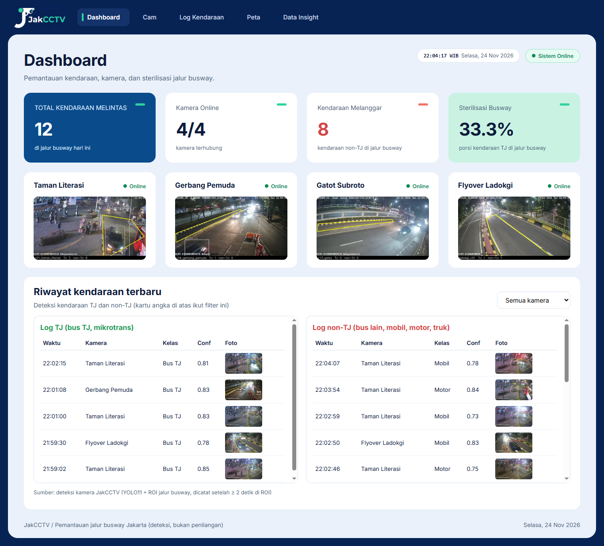
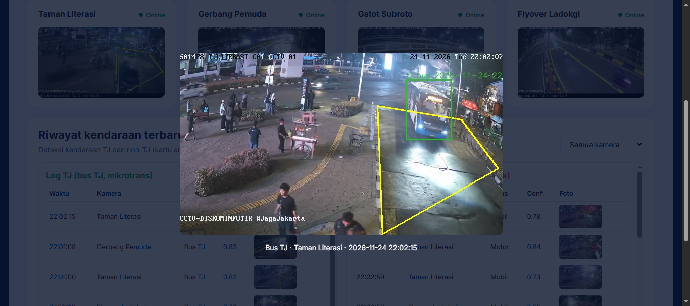
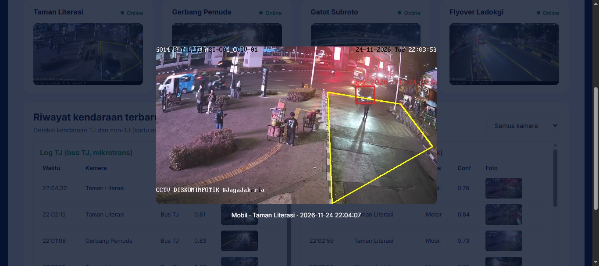
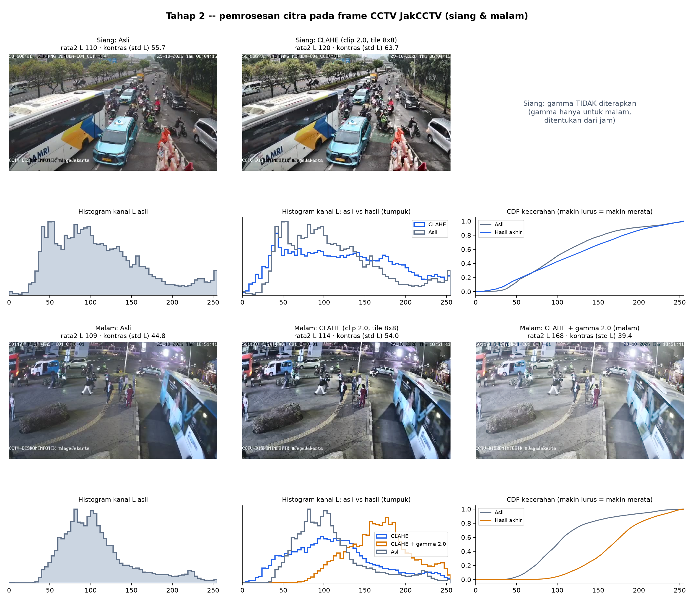
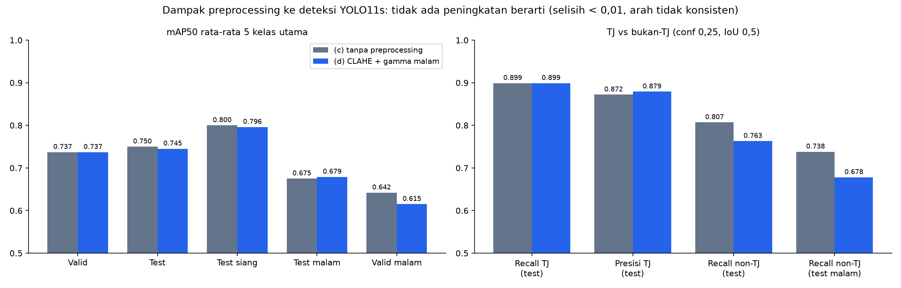

# JakCCTV Busway Monitor: Transjakarta vs non-Transjakarta

Real-time monitoring of who uses Jakarta's **busway lane**. The system reads Jakarta's public CCTV (JakCCTV), detects vehicles with a fine-tuned **YOLO11s**, tracks them with ByteTrack, and logs each vehicle that stays in the busway lane as **Transjakarta (TJ)** or **non-TJ**. Results appear on a 5-page web dashboard (live cameras, vehicle log, map, insights).

> This is a **monitoring / research** project, not a ticketing system. No faces or licence plates are identified.

Built by IPB University students for the course *Intelligent Computer Vision* (2026).



| TJ bus detected in the busway ROI | Non-TJ vehicle in the busway ROI |
|---|---|
|  |  |

## Highlights

| Metric (test set, 161 images, unseen days) | Value |
|---|---|
| `tj_bus` precision / recall / mAP50 | 0.894 / 0.851 / **0.933** |
| Mean mAP50 / mAP50-95, 5 main classes | 0.750 / 0.565 |
| Day / night mAP50 | 0.800 / 0.675 |
| Non-TJ vehicles misread as TJ | 1 of 1,312 |
| Live accuracy, checked by hand on the dashboard (24 Nov 2026) | 95.2% (40/42) |
| CPU latency (laptop, 640 px) | ~387 ms / image (real-time on a T4 GPU) |

## How it works

```
JakCCTV HLS stream ─► frame quality filter (black / frozen frames)
                    ─► YOLO11s detection (7 classes) + ByteTrack
                    ─► busway ROI polygon (bottom-centre point inside ≥ 2 s)
                    ─► majority vote of the class over the track
                    ─► log TJ / non-TJ + snapshot ─► FastAPI dashboard
```

Classes: `tj_bus`, `bus_lain` (other bus), `car`, `motorcycle`, `truck`, `mikrotrans` (JakLingko minibus), `kend_prioritas` (ambulance / fire / police).

**Image processing study.** We tested CLAHE (on the L channel of LAB) plus night-time gamma correction, bilateral denoising, glare suppression and unsharp masking. CLAHE raised daytime contrast (std L 48.4 → 55.9), but the model trained on CLAHE images was not better (mAP50 0.745 vs 0.750 without it). The final system therefore uses no preprocessing; YOLO's own HSV augmentation already covers brightness changes. Details and figures: [`docs/img/`](docs/img), [`src/preprocessing.py`](src/preprocessing.py), [`src/figur_pemrosesan_citra.py`](src/figur_pemrosesan_citra.py).

| CLAHE, day vs night | Effect on the model |
|---|---|
|  |  |

## Run it

### Option A: Kaggle GPU (recommended, nothing to install)
1. Import [`notebooks/dasbor_kaggle.ipynb`](notebooks/dasbor_kaggle.ipynb) into Kaggle. Settings: **GPU T4**, **Internet on**.
2. Run all. Cell 1 clones this repo, and cell 5 prints a public `trycloudflare.com` link for viewers plus an **admin** link (keep it private; it can switch cameras and verify detections).
3. Add `?lang=en` to the link for the English interface. A toggle is also in the header.

### Option B: local
```bash
pip install -r requirements.txt        # plus ffmpeg on PATH
python dashboard/server.py             # http://localhost:8000
```
Use a single image or video with the model directly:
```python
from ultralytics import YOLO
m = YOLO("hasil_training_v2/runs/tj_v2/weights/best.pt")
m.predict("frame.jpg", conf=0.25, save=True)
```

## Repository layout

| Path | Content |
|---|---|
| `dashboard/` | FastAPI server (`server.py`), live camera manager (`live.py`), web UI (`static/index.html`), API notes |
| `src/` | capture, preprocessing, auto-labelling (YOLO11x + CLIP clustering), dataset assembly, evaluation, monitoring logic |
| `config/` | `config.yaml` (cameras, thresholds, model), `roi/` busway polygons per camera, dataset split |
| `notebooks/` | Kaggle notebooks: auto-labelling, bus classification, training (with/without CLAHE), dashboard |
| `hasil_training_v2/runs/tj_v2/` | trained weights `weights/best.pt` (19 MB), training curves and settings |
| `outputs/evaluasi_v2/` | test metrics: per class, day/night, TJ vs non-TJ |

## Dataset

The dataset (1,401 human-checked images, 13,029 boxes, 7 classes, split by camera and date) is published separately on Kaggle: *JakCCTV Busway TJ vs Non-TJ (YOLO)*. Raw recordings are not in this repository.

## Limitations

- Trained and tested on 4 cameras only. Other viewpoints need new ROI and likely more data.
- `bus_lain` (other bus) is often confused with truck/car (recall 0.575). Motorcycles at night are weaker.
- Little heavy-rain or fog data. The dashboard depends on the public JakCCTV streams being online.

## Licence & attribution

- Code and model weights: **AGPL-3.0** (the model is derived from [Ultralytics YOLO11](https://github.com/ultralytics/ultralytics), which is AGPL-3.0). See [`LICENSE`](LICENSE).
- Images: JakCCTV public CCTV, Jakarta Provincial Government, https://jakcctv.jakarta.go.id/publik. Use for non-commercial research and education only.
- Dataset labels: CC BY-NC-SA 4.0.

---

**Bahasa Indonesia.** Sistem pemantauan jalur busway dari CCTV publik JakCCTV: YOLO11s hasil fine-tune membedakan bus Transjakarta dan kendaraan lain di jalur busway, lalu hasilnya tampil di dasbor web 5 halaman (tersedia bahasa Indonesia dan Inggris). Ini pemantauan, bukan penilangan. Cara menjalankan: buka `notebooks/dasbor_kaggle.ipynb` di Kaggle (GPU T4, Internet on), lalu Run All.
